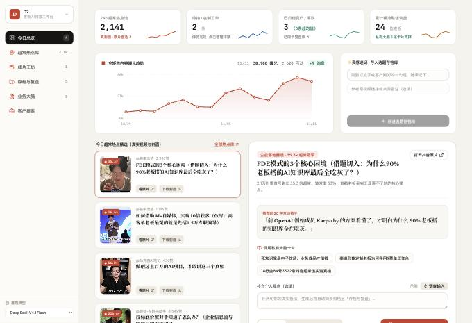
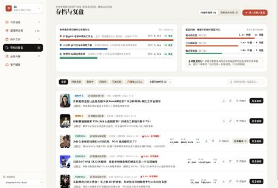

# BossDesk · 老板 AI 情报与私有业务大脑

> 一个面向高客单老板与专业合伙人的本地工作台原型：**24h 超常情报雷达 + 私有业务大脑 + 双轨内容产出**。
>
> 每天早上把「同行刚爆的真选题 + 行业最新情报 + 老板自己的案例经验」洗成当天可拍的口播稿、小红书图卡和客户提案。



---

## 这是什么

BossDesk 不是一个「让老板手动填表、复制 Prompt」的电子台账，而是一套围绕**结果**设计的工作台原型：

- **输入**：公开平台上的同赛道爆款、行业资讯、老板的语音/案例沉淀。
- **处理**：超常值（Outlier）筛选、双链知识卡片检索、结构化脚本生成、排版渲染。
- **输出**：带情绪停顿标记的口播稿、手机提词器、小红书 6 图卡片、客户诊断提案书。

原型内置三个可切换的行业工作区（`d2-studio` / `sartoria-image` / `apex-trade`），用于演示同一套内核如何通过行业 Profile 换肤交付给不同客户。

> ⚠️ 这是一个**产品原型 / Demo**，不是生产级 SaaS。数据、登录、多租户、计费均未实现。

---

## 核心模块

| 模块 | 作用 | 关键能力 |
| --- | --- | --- |
| **今日总览** | 每天 15 分钟的批阅台 | KPI 磁贴、14 日曝光趋势、今日超常热点精选、灵感速记 |
| **超常热点库** | 找「同体量真爆款」 | 15 赛道筛选、超常倍数排序、封面画廊 / 紧凑列表、原片直达、封面下载 |
| **成片工坊** | 把选题变成成品 | 口播逐字稿、情绪停顿标记、手机滚动提词器、小红书图卡套件 |
| **存档与复盘** | 内容资产沉淀 | 状态流转、归纳文件夹、账号矩阵对比、爆款题型统计、高转化开头库 |
| **业务大脑** | 私有知识库 | Markdown 双链卡片、语音/文字入库、原话口吻库、AI 腔禁用词 |
| **客户提案** | 把专业能力变成可售方案 | 基于知识卡与行业插件生成客户诊断提案书 |


<p align="center">
  
  
</p>

---

## 技术栈

| 层 | 选型 |
| --- | --- |
| 前端 | React 19、Vite 6、Tailwind CSS 4、Framer Motion、Lucide |
| 后端 | Express 5、`tsx` 直接运行 TypeScript、`node:sqlite` |
| 渲染 | `html-to-image` + `jszip` 导出小红书图卡 |
| 字体 | Instrument Serif / Newsreader / Noto Serif SC / JetBrains Mono |

前后端同仓：`server/index.ts` 在开发模式下挂载 Vite 中间件，并暴露 `/api/*` 接口。

---

## 快速开始

要求 **Node.js >= 22.5**（依赖内置 `node:sqlite`）。

```bash
npm install
npm run dev
```

打开 <http://localhost:5188>。

生产模式：

```bash
npm run build
npm run preview
```

### 可选：接入大模型

脚本生成、拆解、提案等 AI 能力通过一个 **OpenAI 兼容的本地网关**调用。默认地址：

```
http://127.0.0.1:3425/v1/chat/completions
```

可用环境变量覆盖：

```bash
export MAGPIE_GATEWAY_URL="http://127.0.0.1:3425/v1/chat/completions"
```

未接入网关时，浏览、筛选、存档、图卡排版等本地功能仍可使用，只有生成类接口会失败。

### 可选：实时巡检

「超常热点库 → 实时巡检」依赖本机的 [`monid`](https://app.monid.ai/) CLI：

```
~/.local/bin/monid
```

未安装时该接口会返回明确提示，不影响其余功能。

---

## 目录结构

```
.
├── src/
│   ├── App.tsx                 # 布局、导航、工作区切换
│   ├── components/             # 提词器、小红书图卡套件
│   ├── views/                  # 六个核心工作区
│   └── types.ts                # 前后端共享类型
├── server/
│   ├── index.ts                # Express API + Vite 中间件
│   ├── radarDataset.ts         # 超常数据集装载与赛道统计
│   ├── llmGateway.ts           # 多模型回退的 LLM 网关调用
│   ├── seedWorkspaces.ts       # 三个演示工作区与知识卡
│   └── data/
│       ├── videos_rich.json    # 示例超常视频数据（120 条）
│       └── track_table.csv     # 15 赛道汇总指标
├── workspaces/                 # 演示用双链知识库（Markdown）
└── docs/screenshots/           # 界面截图
```

主要 API：

```
GET  /api/bootstrap
GET  /api/radar
POST /api/radar/live-scan
POST /api/radar/deconstruct
POST /api/studio/generate
POST /api/studio/rewrite-beat
POST /api/brain/ingest
POST /api/hooks
POST /api/dealdesk/generate-stream
POST /api/vault
GET  /api/media/image
```

---

## 数据说明

- 仓库内 `server/data/videos_rich.json` 是从完整采集库中抽取的 **120 条示例数据**（覆盖 15 个赛道），仅用于演示界面与交互。
- 原始采集缓存、带登录态字段的 `exec_raw`、封面图片缓存、本地运行数据库均**未入库**，并已写入 `.gitignore`。
- 示例中的视频标题、作者、链接均来自公开页面采集；相关权利归原作者与平台所有，仓库仅作技术演示，不构成对第三方内容的再授权。
- `workspaces/` 中的客户案例为脱敏/虚构演示内容。

---

## 已知限制

- 单机原型：无账号体系、无权限隔离、无多租户。
- 知识库为本地 Markdown + 轻量检索，未接入向量数据库。
- 抓取与实时巡检依赖第三方 CLI 与平台接口，可能因风控或接口变更失效。
- 生成质量取决于所接入的模型。

---

## License

未附开源许可证，代码仅用于展示与学习，保留所有权利。
